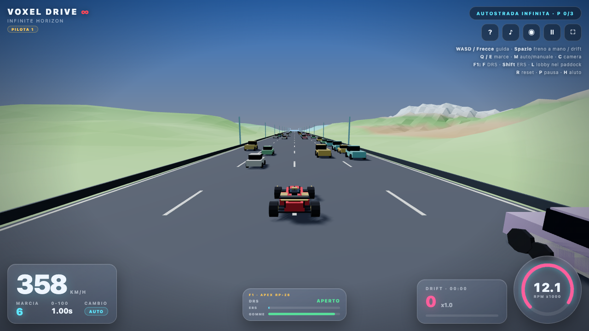
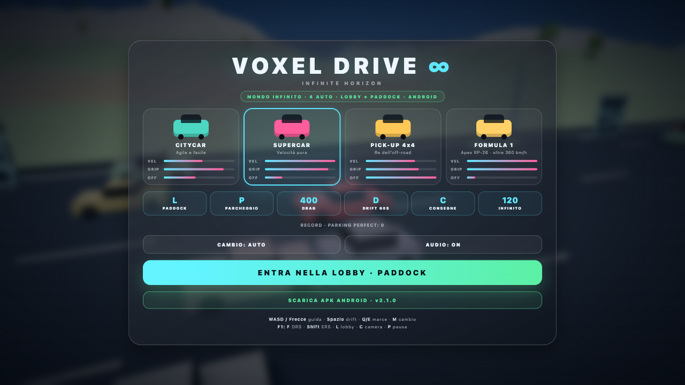
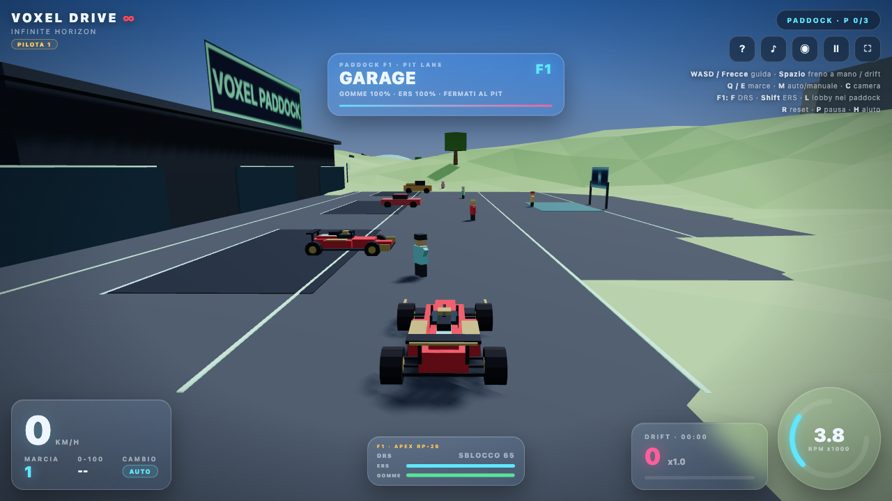
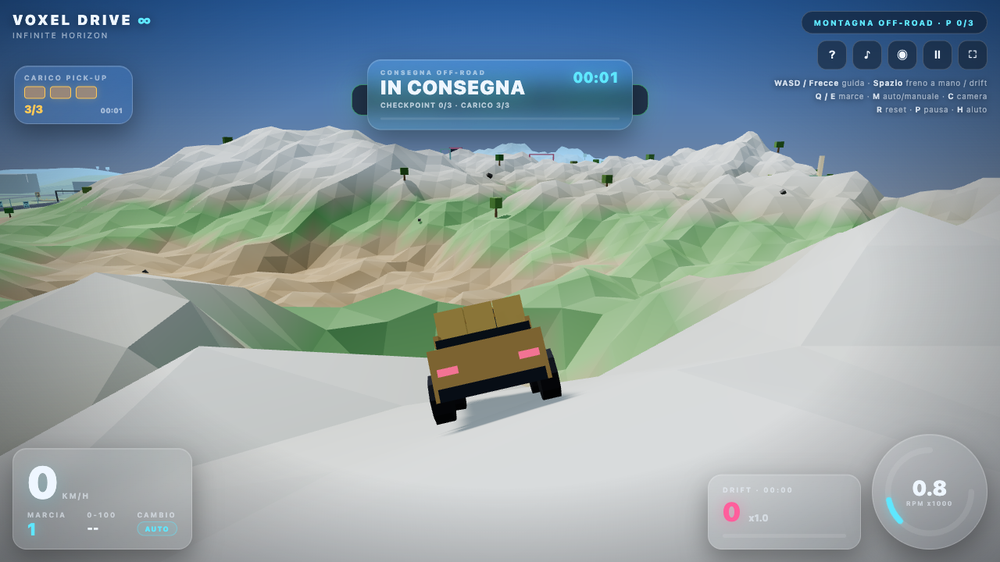
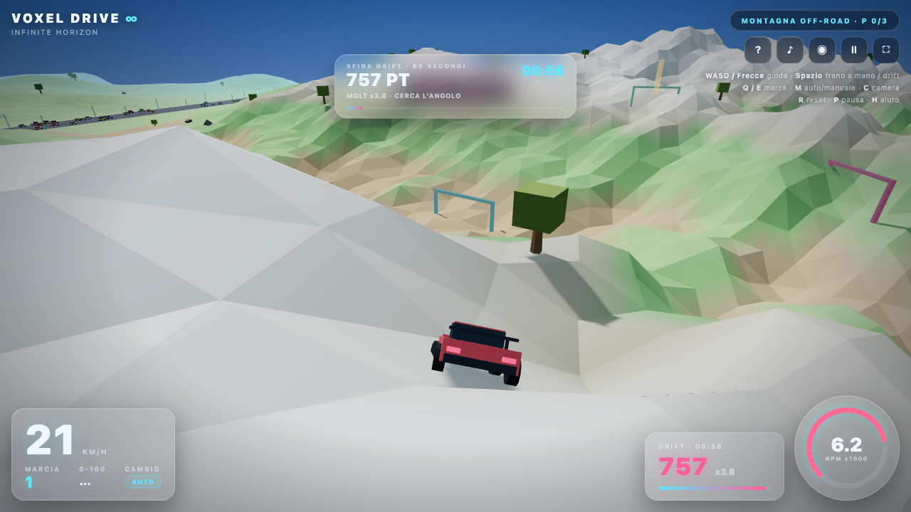
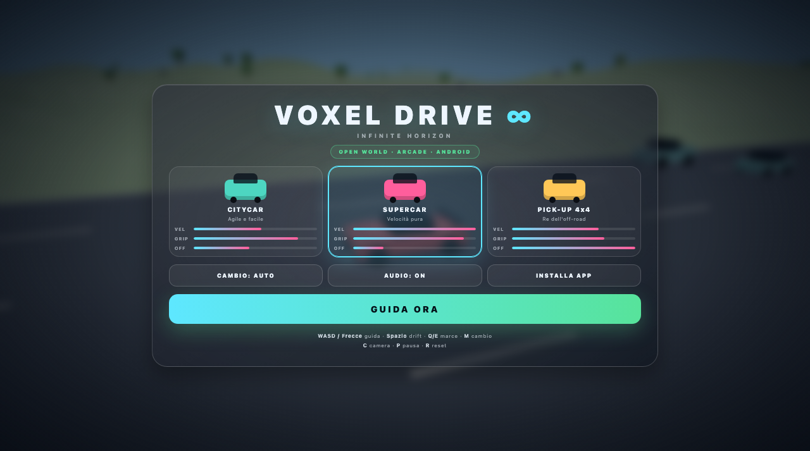

# Voxel Drive: Infinite Horizon

**Open-world voxel driving senza confini: mondo procedurale in streaming, lobby locale con paddock 3D, 4 auto inclusa la Formula 1, 5 sfide e un APK Android.**

[](https://giuseppelia890-tech.github.io/voxel-drive/)
[](apk/VoxelDrive-v2.1.0.apk)
[](https://github.com/giuseppelia890-tech/voxel-drive/releases/tag/v2.1.0)



Voxel Drive è un arcade di guida 3D costruito con **Three.js r128**, pensato per girare a **60 fps** su desktop e su Android. Il terreno e l'autostrada sono generati **in streaming attorno al giocatore**: non esiste un bordo della mappa. Si passa dalla **lobby locale** al **paddock 3D** con garage, meccanici e pit lane, si sceglie una delle **4 auto** e si affrontano le 5 sfide. Tutte le meccaniche sono giocabili, senza funzioni tagliate.

---

## Novità v2.1

- **Mondo davvero infinito**: rimosso il limite della mappa; terreno e autostrada sono in streaming procedurale.
- **Lobby + paddock 3D**: nome pilota, scelta modalità, garage, tre auto in mostra, cinque meccanici e pit service.
- **Formula 1 Apex RP-26**: open-wheel, DRS, ERS, downforce, launch control, usura gomme e oltre 350 km/h.
- **HUD e controlli touch F1**: pannello DRS/ERS/gomme e due tasti dedicati sopra lo sterzo.
- **Cache PWA v6** e APK **2.1.0** (versionCode 3).

---

## Indice

- [Novità v2.1](#novità-v21)
- [Le 5 meccaniche](#le-5-meccaniche)
- [Lobby e paddock 3D](#lobby-e-paddock-3d)
- [Formula 1](#formula-1)
- [Il mondo](#il-mondo)
- [Le auto](#le-auto)
- [Controlli](#controlli)
- [Installazione APK Android](#installazione-apk-android)
- [Avvio locale](#avvio-locale)
- [Architettura](#architettura)
- [Build APK da sorgente](#build-apk-da-sorgente)
- [Qualità e prestazioni](#qualità-e-prestazioni)
- [Screenshot](#screenshot)

---

## Le 5 meccaniche

### 1. Parcheggio estremo al millimetro

Tre piazzole delimitate da blocchi e linee luminose: **Città Neon**, **Area di sosta** e **Parcheggio montano**.

- Tutte e quattro le ruote devono essere **dentro le linee**.
- Il **PERFECT** viene assegnato solo con auto **perfettamente parallela** (errore ≤ **1,5°**), centro piazzola entro **18 cm** e veicolo fermo (< 0,2 m/s) per **1,2 secondi**.
- Un offset di 125 cm viene classificato **RUOTA FUORI LINEA**; un'auto storta di 11,5° viene classificata **ALLINEA** e non completa la piazzola.
- Feedback in tempo reale: angolo, offset in cm, barra di precisione, grado (`ALLINEA`, `BUONO`, `OTTIMO`, `PERFECT`) e contatore `P x/3`.
- I record delle tre piazzole sono salvati in locale.

### 2. Drag race 400 m con cambio manuale

- Striscia da **400 metri** sull'autostrada, con semaforo a 4 luci e countdown di **3,2 secondi**.
- Allo staging si tiene **freno + gas**; il contagiri sale e il launch control valuta i giri al rilascio.
- **Cambio manuale a 6 marce** con rapporti reali (`gearRatios`, `finalDrive`, RPM calcolati dalla velocità delle ruote) e tachimetro.
- **Q / E** (desktop) oppure **− / +** (touch) per scalare e salire.
- Troppo gas → **WHEELSPIN** e perdita di trazione; pochi giri → **BOG** e accelerazione ridotta; finestra RPM corretta → **LAUNCH PERFETTO**.
- Tempo sul traguardo, record personale e luci di partenza animati.

### 3. Sfida drift cronometrata

- Zona dedicata in montagna, raggio **92 m**, sessione da **60 secondi**.
- Il freno a mano (**Spazio**) o una sterzata violenta ad alta velocità fanno perdere aderenza alle ruote posteriori.
- La fisica calcola lo **slip angle** e la componente laterale della velocità; i punti crescono con **angolo × velocità × durata** e moltiplicatore live.
- Timer, punti della sessione, punti live e moltiplicatore sono sempre a schermo. Il drift libero continua ad accumulare punti anche fuori dalla sfida.

### 4. Traffico distruttibile

- **120 auto ambientali simultanee**, costruite con **`THREE.InstancedMesh`**: carrozzerie, abitacoli, tetti e ruote sono istanze separate, con colore per istanza.
- Traffico su autostrada e strade cittadine, con respawn attorno al giocatore.
- Gli urti ad alta velocità causano **carambole a catena** fino a 3 livelli di propagazione, **deformazione visibile** dei blocchi (schiacciamento, inclinazione, crumple) e detriti fisici.
- Le auto distrutte volano, rotolano e vengono riciclate dopo il reset.

### 5. Consegne off-road con carico fisico

- Il **Pick-up 4x4** ha un cassone con **3 cubi di carico** fisici.
- Al depot si carica il carico, poi si raggiungono **3 checkpoint** tra le montagne.
- I cubi seguono il pianale finché il veicolo resta stabile; con un dosso violento (**jolt > 37**), rollio eccessivo (**> 0,92 rad**), ribaltamento o urto contro ostacoli/traffico vengono **espulsi** e cadono sotto gravità.
- Perdere un solo cubo fa fallire immediatamente la consegna. Timer, integrità del carico (`3/3`) e checkpoint sono nella HUD.

---

## Lobby e paddock 3D

- **Lobby locale** prima di ogni modalità: nome pilota persistente, auto selezionata, sei modalità e pulsante **READY**.
- **Paddock fisico** a est della drag strip: garage con tre auto in esposizione, cinque meccanici animati, pit lane, arco d'ingresso e accesso dall'autostrada.
- Dopo il READY si entra con l'auto nella zona 3D. Il tasto **L** (o **LOBBY / PADDOCK** in pausa) riapre la lobby; la lobby è **locale**, senza server o multiplayer online.
- Al pit, fermandosi con la F1, i meccanici cambiano le gomme e ricaricano l'ERS.
- La modalità **PADDOCK** fa partire dal vialetto d'accesso: si attraversa l'arco e si esplora il paddock guidando.

## Formula 1

La **Apex RP-26** è la quarta auto guidabile:

- Modello **open-wheel voxel** con ali, halo, pance laterali, sospensioni, gomme larghe e flap DRS animato.
- Velocità massima estrema: oltre **330 km/h** di base, fino a circa **370 km/h** con DRS + ERS.
- **DRS** (`F` / touch **DRS**): riduce la resistenza sopra i 65 km/h e si chiude automaticamente in frenata, fuori pista o a bassa velocità.
- **ERS** (`Shift` / touch **ERS**): boost elettrico con barra dedicata; si ricarica in frenata e al pit.
- **Downforce** progressivo: più velocità significa più grip, ma anche resistenza indotta.
- **Launch control**, cambio a 6 marce, usura gomme e pit service completo.

---

## Il mondo

- **Mondo infinito**: nessun limite fisso di coordinate; terreno, autostrada, guard rail, lampioni e trattini vengono generati in **chunk da 300 m** attorno al giocatore, con riciclo continuo (5×5 chunk attivi).
- Tre biomi senza confini:
  - **Città Neon** — grattacieli voxel, strade a griglia, parcheggi e traffico urbano.
  - **Autostrada Infinita** — 4 corsie, guard rail, lampioni e drag strip da 400 m.
  - **Montagna Off-road** — dune, rocce, pendenze, porte drift e percorso consegne; la catena montuosa continua proceduralmente.
- Terreno irregolare con curve, dossi e ostacoli; sospensioni a 4 punti e fisica separata per asfalto/off-road.
- Cielo, luci, ombre, vegetazione e segnaletica generati proceduralmente.
- Audio Web Audio API generato in tempo reale (motore, slittamento, urti, feedback), con mute persistente.
- Salvataggio locale di record, piazzole completate, tempi drag/drift/consegne e preferenze.

## Le auto

| Auto | Velocità max | Grip | Off-road | Note |
|---|---:|---:|---:|---|
| **Citycar** | ~158 km/h | alto | medio | Agile, facile da parcheggiare |
| **Supercar** | ~209 km/h | massimo | basso | Accelera e frena meglio |
| **Pick-up 4x4** | ~173 km/h | medio | massimo | Cassone con 3 cubi, ideale per le consegne |
| **Formula 1 Apex RP-26** | ~370 km/h con DRS + ERS | altissimo | minimo | Open-wheel, DRS, ERS, downforce e usura gomme |

Tutte hanno **6 marce** con rapporti dedicati, cambio automatico o manuale, sospensioni a 4 punti, rollio/beccheggio, wheelspin, freno a mano e usura della trazione fuori strada. La F1 aggiunge DRS, ERS, downforce, launch control e pit service.

## Controlli

| Azione | Desktop | Touch |
|---|---|---|
| Accelerare | `W` / `↑` | ▲ |
| Freno | `S` / `↓` | ▼ |
| Sterzo | `A` `D` / `←` `→` | ◀ ▶ |
| Freno a mano / drift | `Spazio` | **DRIFT** |
| Marcia su / giù | `E` / `Q` | **+** / **−** |
| Auto / manuale | `M` | **AUTO** nella HUD o **+ / −** |
| Camera | `C` | ◉ |
| **DRS (F1)** | `F` | **DRS** |
| **ERS / boost (F1)** | `Shift` | **ERS** |
| **Lobby nel paddock** | `L` | **LOBBY / PADDOCK** in pausa |
| Reset sfida | `R` | — |
| Pausa | `P` / `Esc` | **II** |
| Aiuto | `H` | **?** |

Su touch il pad delle marce è sempre visibile durante la guida: il primo tocco su **+ / −** passa automaticamente al cambio manuale.

## Installazione APK Android

L'APK è **firmato** e pronto per il sideload:

- File: [`apk/VoxelDrive-v2.1.0.apk`](apk/VoxelDrive-v2.1.0.apk)
- Pacchetto: `com.voxeldrive.infinitehorizon`
- Versione: `2.1.0` (versionCode 3)
- Min SDK: **24** (Android 7.0) · Target SDK: **35**
- Orientamento: **sensorLandscape**, WebView immersiva a schermo intero
- SHA-256: `c6e9746b84d558004717b193b3e7e7199b00fb0aab5e6fbf10372d5118ca9162`

Passaggi:

1. Scarica l'APK sul telefono (dal link sopra o dalla Release GitHub).
2. Apri il file e consenti l'installazione da **origini sconosciute** per il browser/file manager.
3. Avvia **Voxel Drive**: il gioco carica gli asset locali dall'APK, senza bisogno di connessione per Three.js.
4. Tieni il telefono in orizzontale. Il tasto Back mette in pausa; premi Back due volte per uscire.

> L'APK è self-signed, non è pubblicato sul Play Store. La firma è locale e viene usata solo per l'installazione.

## Avvio locale

Il gioco è composto da file statici. Dalla cartella del progetto:

```bash
python3 -m http.server 8765
```

Apri <http://localhost:8765/>. Non serve build, bundler o `npm install`: Three.js viene caricato dalla CDN con fallback automatico a `vendor/three.min.js`.

## Architettura

```
index.html          HUD, lobby, menu, aiuto, controlli touch, car script
style.css           UI overlay trasparente, lobby, HUD desktop/mobile, pannelli sfida
physics.js          VD.VehiclePhysics: motore, 6 marce, DRS/ERS, downforce, usura
world.js            VD.World: chunk procedurali 5×5, autostrada infinita, paddock 3D
cars.js             VD.CAR_DEFS (4 auto), buildCar open-wheel, cargo, TrafficSystem
game.js             loop 60 Hz, lobby, input, camera, HUD, audio, sfide, record, PWA
sw.js               service worker offline (cache v6)
manifest.webmanifest PWA landscape/fullscreen
vendor/three.min.js Three.js r128 locale (fallback CDN)
android/            progetto Android nativo (WebView, manifest, risorse)
tools/build-apk.sh  build APK: aapt2 → javac → d8 → zipalign → apksigner
apk/                APK firmato pronto al download
```

Scelte tecniche principali:

- **Script classici + namespace globale `VD`**, non moduli ES: l'APK può caricare `file:///android_asset/` senza problemi di CORS.
- **Loop fisico a passo fisso 60 Hz** con accumulator, indipendente dal refresh del display.
- **Streaming del mondo**: 25 chunk da 300 m (5×5) intorno all'auto; il terreno viene ricalcolato e riciclato senza pop-up ai bordi.
- **Un solo canvas WebGL**: ~95–230 draw call con 120 auto, chunk, paddock e garage, grazie a `InstancedMesh` e materiali condivisi.
- **PWA** con service worker: dopo la prima visita il gioco funziona offline.
- **Camera chase smorzata** con tre modalità, shake sugli urti e look-ahead in curva.

## Build APK da sorgente

Requisiti: macOS, Android SDK con **build-tools 36.0.0** e **platform android-35**, JDK **17** (Temurin), `sips`, `zip`, `openssl`.

Il progetto include un JDK portatile in `.tooling/` (non versionato). Per rigenerare l'APK:

```bash
export JAVA_HOME="/percorso/di/jdk-17/Contents/Home"
export ANDROID_HOME="$HOME/Library/Android/sdk"
./tools/build-apk.sh
```

Lo script:

1. copia gli asset web in `assets/www`, rimuovendo la CDN (nell'APK Three.js è sempre locale);
2. genera le icone mipmap dalle icone PWA;
3. compila risorse e manifest con `aapt2`;
4. compila `MainActivity.java` con `javac --release 8`;
5. converte le classi in `classes.dex` con `d8`;
6. allinea con `zipalign` e firma con `apksigner`;
7. verifica la firma e stampa badging + SHA-256.

La chiave è in `.android/keystore/` (ignorata da Git). Se non esiste, viene creata automaticamente. L'APK viene scritto in `apk/VoxelDrive-v2.1.0.apk`.

## Qualità e prestazioni

Test automatici eseguiti su Chrome headed (1280×720 e 844×390 touch):

- **29/29 test desktop superati**, **0 errori JavaScript**; test touch dedicato superato.
- **59,9 fps** medi con 120 auto, ~90k triangoli e fino a 230 draw call.
- Lobby: apertura, nome pilota, 6 modalità e READY verificati.
- Paddock: spawn fisico, 3 auto in esposizione, 5 meccanici e pit service.
- Mondo infinito: auto a **z = 1200** senza clamp, 25 chunk attivi e 480 trattini riciclati.
- F1: DRS aperto, ERS in consumo, usura gomme, downforce e reset al pit verificati.
- Parcheggio: PERFECT a 0 mm/0,0°, rifiuto a 125 cm fuori linea e a 11,5°.
- Drag: staging a 7.486 RPM, lancio con **WHEELSPIN**, traguardo e record.
- Consegna: 3 cubi caricati, espulsione con gravità, fallimento immediato, 3 checkpoint completati.
- Drift: 758 punti con freno a mano, timer 60 s e slip angle 1,46 rad.
- Traffico: catena di 10 auto distrutte con deformazione.
- PWA: service worker **v6** attivo e **avvio offline** verificato.
- APK: assets `file://` verificati (Three.js locale, 120 auto, guida funzionante).

## Screenshot

| Menu e selezione auto | Formula 1 sulla autostrada infinita |
|---|---|
|  |  |
| **Lobby / paddock 3D** | **Consegna off-road** |
|  |  |
| **Drift in montagna** | **Parcheggio Perfect** |
|  |  |

---

**Three.js** © three.js authors, licenza MIT. Modelli, mondi, fisica e UI di Voxel Drive sono generati proceduralmente nel progetto.
